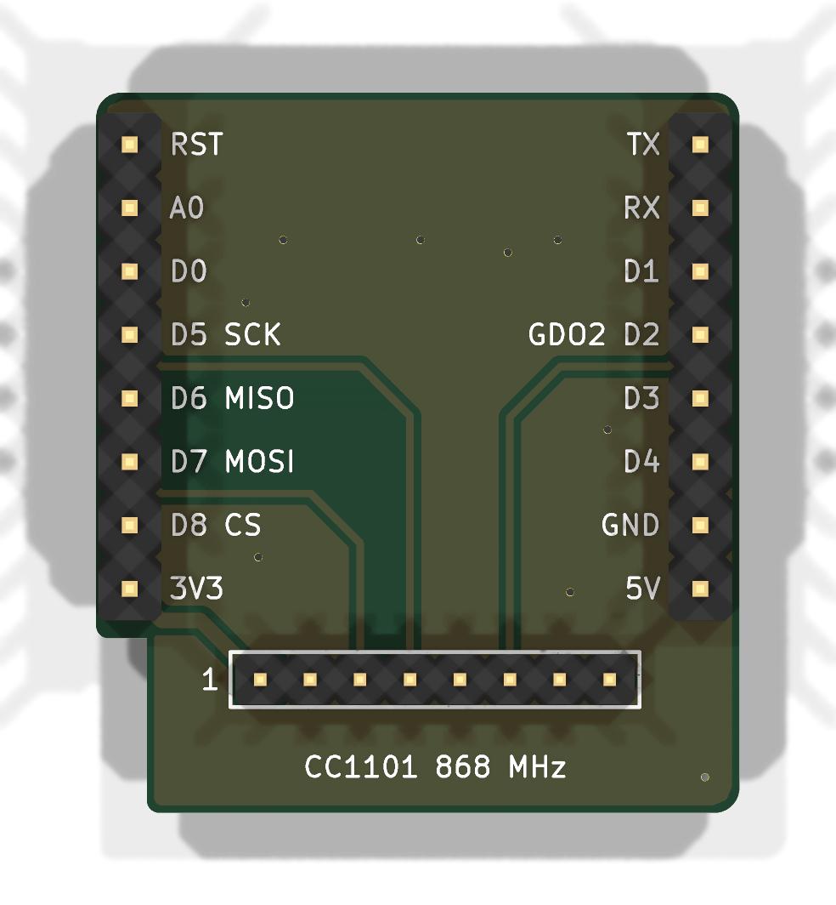
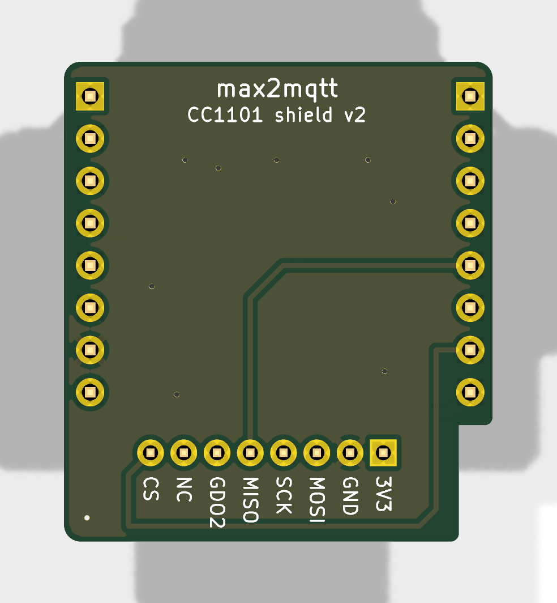

# CC1101 shield

A CC1101 868 MHz radio module on a shield for D1-mini-sized boards (HW-665 / ESP32-WROOM-32, Lolin C3 Mini).

| Top | Bottom |
|---|---|
|  |  |

To order it, upload [`fab/cc1101-shield-gerbers.zip`](fab/cc1101-shield-gerbers.zip) to a PCB maker (2 layers,
1.6 mm, anything standard). The schematic is [`fab/cc1101-shield-schematic.pdf`](fab/cc1101-shield-schematic.pdf).

| Module pin | | D1 mini | ESP32 (HW-665) |
|---|---|---|---|
| 1 VCC | 3.3 V | 3V3 | |
| 2 GND | | GND | |
| 3 MOSI | | D7 | GPIO23 |
| 4 SCLK | | D5 | GPIO18 |
| 5 MISO | | D6 | GPIO19 |
| 6 GDO2 | packet received | D2 | GPIO21 |
| 7 GDO0 | not connected | | |
| 8 CSN | chip select | D8 | GPIO5 |

The pins are as the firmware expects them (`esp/src/board.rs`).

## v2

Same outline and hole positions as v1, so it fits the same boards and modules. Changed, from the notes in
[troubleshooting.md](troubleshooting.md):

- 3V3 and GND reach the module as 0.6 mm tracks. On v1 they were copper fills only, which pulled the heat away
  from the iron: those four joints were the ones that failed.
- The module's 2 mm header has 1.6 mm pads around 0.9 mm holes (v1: 1.2 mm around 0.81 mm, a 0.19 mm ring).
- GDO0 is not connected. On v1 it went to D3, which is GPIO0 on the D1 mini and must be high at boot, while the
  CC1101 puts a clock on it after reset.
- Ground fill on both sides, stitched with vias.
- Tracks run between the pin rows, so the pin labels stay readable; the module's pin names are on the bottom,
  next to the joints.

Still true of v2: GDO2 (D2) is GPIO8 on the C3 Mini, a strapping pin, so flash a C3 the first time with the
shield unplugged. Keep the module's coil antenna away from the board's Wi-Fi antenna.

v2 has not been made yet. v1 as built is in [`v1/`](v1): its Gerbers and the EasyEDA Pro project.

## Changing it

The board is written by [`generate.py`](generate.py): the parts, every track and the outline are in that one
script. Edit it and run `./build.sh` (KiCad 10), which regenerates the KiCad files, fails unless KiCad's
electrical and design rule checks are clean (including that the board matches the schematic), and exports the
Gerbers, the schematic PDF and the pictures. Opening the `.kicad_pro` in KiCad works too, but the next
`./build.sh` overwrites hand edits.
